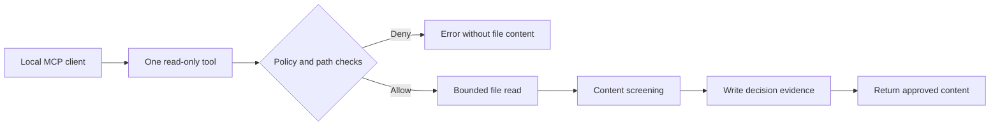

# Twinthos Sentinel

**Give an agent one useful tool. Prove where its permissions stop.**

[](https://github.com/twinthos/ai-sec-sentinel/actions/workflows/ci.yml)
[MIT licensed](LICENSE) · Python 3.11+ · Linux / POSIX · Local MCP stdio

[Try it](#try-it) · [How it works](#how-it-works) · [Privacy](#your-data) · [Roadmap](docs/ROADMAP.md) · [Contribute](CONTRIBUTING.md)

Twinthos Sentinel is an open-source reference for **enforcing a small agent tool boundary**. Its MCP server exposes one policy-checked file reader. Try an approved read, then request a shell command or a private path: the demo checks what actually happens and returns a failing exit code if the boundary breaks.

Built for developers learning to scope agent tools, security engineers writing regression tests, and educators who want an inspectable example. No model account or API key is needed for the demo.

**Status: reference / release candidate.** The boundary applies to the included tool. Connecting Sentinel does not restrict an agent's other tools, secure a whole machine, or establish production readiness.

## Try it

Requires Python 3.11+ on Linux/POSIX. The synthetic MCP proof uses the Python standard library; after cloning, it needs no package download or network access.

```sh
git clone https://github.com/twinthos/ai-sec-sentinel.git
cd ai-sec-sentinel
python3 examples/proof.py
```

Look for `"pass": true` and all ten checks set to `true`. These results come from a real local MCP subprocess and temporary synthetic files:

| Request or observation | Expected result |
| --- | --- |
| Initialize MCP and list tools | Exactly one exposed tool |
| Read an approved document | Allowed |
| Call a shell tool | Denied |
| Escape the workspace or read a hidden secret path | Denied |
| Inspect the outside file | Unchanged |
| Inspect the evidence ledger | Document contents absent |
| Close the server | Clean exit |

For a plain-language result and the rest of the toolkit:

```sh
python3 -m venv .venv
. .venv/bin/activate
python -m pip install -r requirements.txt
python ai_sec_sentinel.py --quickstart
```

The first result should be:

```text
PASS: an approved file was read; shell calls and private paths were blocked.
```

Running `python ai_sec_sentinel.py` without arguments shows the starting command. A failed quickstart exits nonzero. [Troubleshooting and contributor setup →](CONTRIBUTING.md)

## How it works



The host supplies the workspace, policy and agent identity. File access uses POSIX directory descriptors and no-follow flags; unknown tools, traversal and symlinks are rejected. A decision must be recorded before content returns. The server exposes no shell, network or write tools.

**Your integration must remove alternate paths to those privileges.** An agent that retains a separate unrestricted file reader or shell can bypass this boundary. Allowed document text is still untrusted, and pattern-based content screening cannot recognize every confidential fact.

[Connect a local MCP client →](docs/AGENT-BOUNDARY-DEMO.md) · [Threat model →](docs/THREAT_MODEL.md) · [Test-to-claim evidence →](docs/EVIDENCE.md)

## Choose a workflow

| Goal | Start with | Network / data |
| --- | --- | --- |
| Verify the tool boundary | `python examples/proof.py` | Offline; synthetic files |
| Triage sample cloud events | `python defensive_event_triage.py --input examples/fixtures/synthetic_cloud_events.jsonl` | Offline; aggregate signals |
| Develop and test | `python -B -m unittest discover -s tests -v` | Synthetic offline tests |
| Preview public security feeds | `python ai_sec_sentinel.py --dry-run --since-hours 24` | Online; no notifications |
| Configure notification delivery | [Live monitoring guide](docs/LIVE-MONITORING.md) | Online; explicit destination |

Cloud triage accepts normalized events; it is not a live Microsoft 365 integration. Feed monitoring uses relevance heuristics; it is not comprehensive dependency auditing. Guardian Gate and Dashboard are separate optional processes, not automatic enforcement of arbitrary agent actions.

## Your data

- **Demo:** temporary synthetic files; no personal documents, model API calls or notifications.
- **Runtime state:** defaults to `~/.local/share/twinthos-sentinel`, outside the checkout. Set `SENTINEL_DATA_DIR` to override it. Existing state is not automatically migrated.
- **Online checks:** OSV receives package names and versions. Raw lockfile upload requires explicit consent and rejects sensitive filenames and symlinks. Feed providers see request metadata. `--dry-run` still uses the network.
- **Notifications:** the chosen provider receives alert content. Common secret and email patterns are redacted, credential-bearing exception URLs are omitted, and notification/dependency POST redirects are disabled. These controls do not guarantee that all private information is removed.
- **Contributions:** use synthetic examples. Never paste credentials, real customer records, private logs or runtime databases into issues, PRs or screenshots.

[Report a vulnerability privately →](https://github.com/twinthos/ai-sec-sentinel/security/advisories/new) · [Security policy →](SECURITY.md)

## Where Sentinel fits

Use evaluation tools to investigate model behavior and runtime isolation to constrain the process. Sentinel supplies a small execution boundary whose allow/deny behavior you can inspect and test.

Our [current ecosystem review](docs/ECOSYSTEM.md) compares this scope with MCP, Promptfoo, NVIDIA garak and Microsoft PyRIT, and records maintenance changes that matter when selecting dependencies. It includes dated primary sources, not adoption rankings or unsupported performance claims.

## Help build the next useful piece

Start with the [roadmap](docs/ROADMAP.md): official-client interoperability, a reproducible isolated host integration, and verified monitoring delivery. Each milestone has concrete acceptance criteria.

Good contributions include a synthetic regression for a bypass, a clearer setup step, or a reproducible integration report. [Contributor guide →](CONTRIBUTING.md)

If the demo helps you, share its synthetic output and the version you tested. A useful bug report or reproducible example helps the next person get a working result.

MIT licensed. Maintained by [Twinthos](https://twinthos.com/security/). No third-party endorsement, independent audit or production support SLA is implied.
